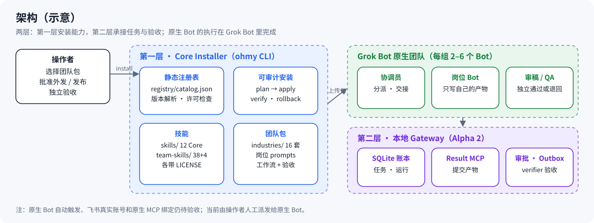
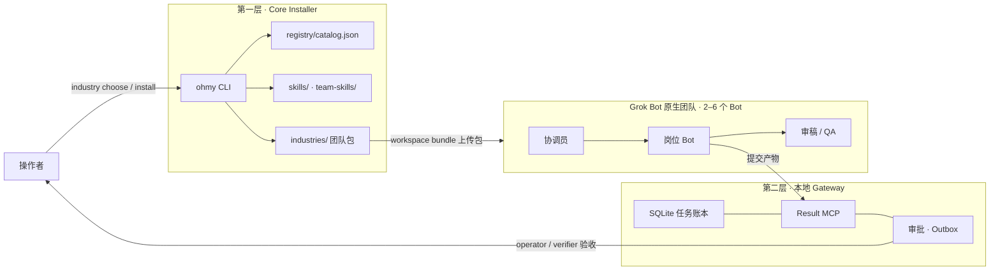
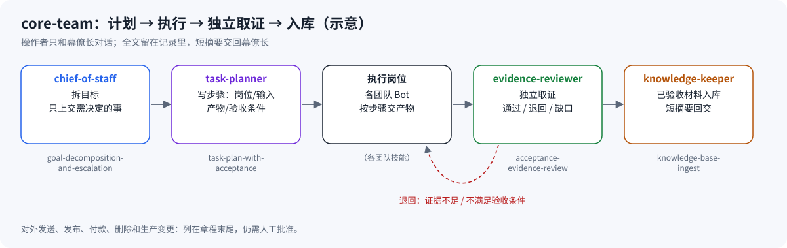
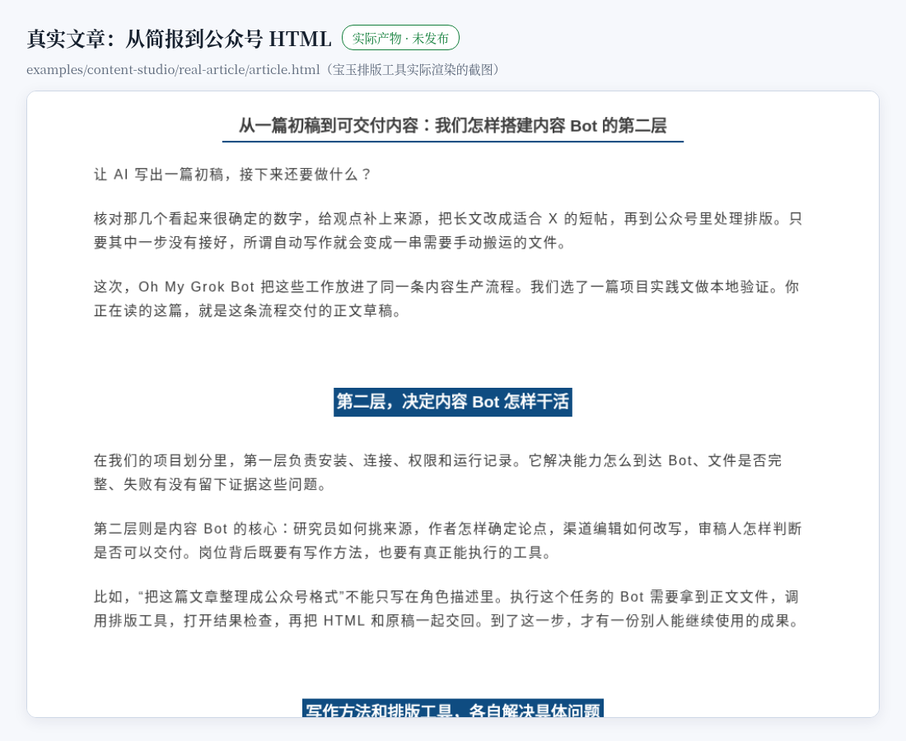
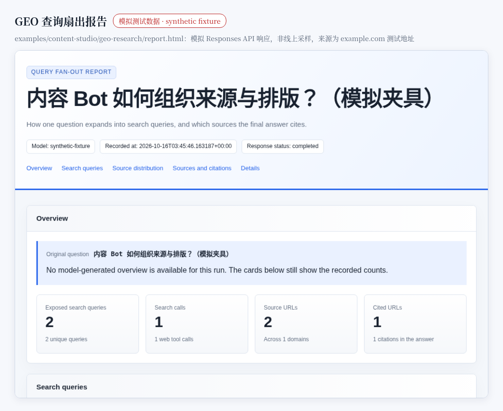
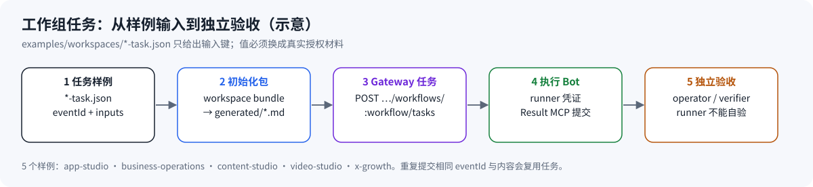
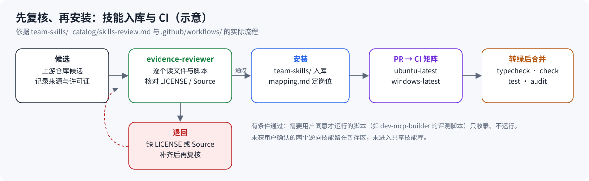

<p align="center">
  
</p>

# Oh My Grok Bot

**把 Grok Bot 组织成分工明确、产物可验收的 Bot 团队。**

> **English summary.** Oh My Grok Bot is a distribution and integration layer for native Grok Bot. It ships 16 team packs (75 roles, 40 workflows) with role prompts and acceptance criteria, 12 core skills plus a reviewed catalog of 38 third-party skills, an auditable local installer (`plan → apply → verify → rollback`), and a local task gateway (SQLite ledger, Result MCP, approvals, independent verification). Resources are `reviewed` development builds; native-account activation still needs to be verified in Grok Bot. The project license is not decided yet (`UNLICENSED`).

<sub>插画里举旗的小圆点叫 **dot**，是本项目的原创吉祥物；标注「示意」的图是流程示意，不是界面截图。</sub>

[快速开始](#快速开始) · [团队包](#团队包总览) · [案例](#案例) · [技能目录](#技能与技能目录) · [架构](#架构) · [参与贡献](#参与贡献) · [许可](#许可)

## 这是什么，为什么要它

一个 Bot 什么都做，产物就很难验收：谁写的、依据是什么、有没有人独立核对过，都说不清。Oh My Grok Bot 把常见工作拆成**团队包**：每个岗位只写自己的产物，交接时带上任务标识、输入来源、产物路径和验收条件，由**独立审稿岗位**通过或退回。发布、外发、付款这类动作一律停在人工批准之前。

项目分两层：

- **第一层 · Core Installer**：静态能力注册表、版本解析、许可检查、可审计的本地安装与回滚。把 Core Skills、团队包和原生配置指引部署到你的工作区。
- **第二层 · 本地 Gateway**：持久化任务账本、受认证的 Result MCP、审批与 Outbox，以及 operator / verifier 独立验收。

当前状态要说清楚：目录中的资源是 `reviewed` 开发版本，尚无独立账号的 `verified` 证明。CLI 不会把「本地文件部署成功」标成「原生团队已经可用」；原生 Bot 导入、账号授权和业务执行仍需在 Grok Bot 中验证。

## 架构

<p align="center"></p>



*示意图。* 原生 Bot 自动触发、飞书真实账号和原生 MCP 绑定仍待验收，当前由操作者人工派发给原生 Bot。模块与契约见 [架构与契约](docs/core-architecture.md)。

## 快速开始

需要 Node.js >=22.14、pnpm 11.7。

```shell
pnpm install --frozen-lockfile --ignore-scripts
pnpm build
pnpm ohmy --help
pnpm ohmy search research --kind skill
pnpm ohmy inspect oh-my-core
```

**装一个团队包**（先勾选，再对选中的包执行 `install`）：

```shell
pnpm ohmy --json industry choose oh-my-content-studio --out selection.json
pnpm ohmy --workspace ./team-workspace install oh-my-content-studio --yes --allow-unverified
```

**生成交给 Grok Bot 的初始化包**，附到 Grok Bot 私聊中，让它创建或复用列出的专职 Bot 并组织群组（详见 [原生群组说明](docs/native-groups.md)）：

```shell
node dist/cli.js workspace bundle --config examples/workspaces.config.json --id app-studio --out examples/workspaces/generated/app-studio.md
```

安装返回 `needs_human`（退出码 2）是预期状态：本地文件已经放下，账号里的 Bot 还要逐个核对。`--allow-unverified` 只放行已审核的开发资源，不能放行 `discovered` 资源。

## 团队包总览

<p align="center"></p>

16 套团队、75 个岗位、40 条工作流。定义在 `industries/<团队>/industry.json`，岗位说明在 `industries/<团队>/prompts/`，上传包在 `examples/workspaces/generated/`。岗位职责与组合用法见 [Bot 操作指南](docs/bot-playbook.md)。

| 团队包 | 群组 | 岗位 | 工作流 |
| --- | --- | ---: | --- |
| [core-team](industries/core-team/README.md) | 核心团队 | 4 | `assign-work` · `retain-knowledge` · `review-week` |
| [research-lab](industries/research-lab/README.md) | 研究实验室 | 6 | `deep-report` · `competitor-scan` · `trend-scan` |
| [content-studio](industries/content-studio/README.md) | 内容生产工作组 | 6 | `produce-piece` · `next-topics` · `geo-content-brief` |
| [wechat](industries/wechat/README.md) | 公众号工作组 | 4 | `capture-voice` · `write-article` |
| [x-growth](industries/x-growth/README.md) | 增长工作组 | 5 | `topic-research` · `content-calendar` · `export-analytics` · `write-thread` · `write-article` |
| [video-studio](industries/video-studio/README.md) | 视频制作工作组 | 5 | `produce-video` · `repurpose-media` |
| [design-studio](industries/design-studio/README.md) | 设计工作室 | 5 | `specify-component` · `motion-audit` |
| [app-studio](industries/app-studio/README.md) | 应用开发工作组 | 5 | `build-feature` · `fix-bug` · `prepare-release` |
| [engineering-lab](industries/engineering-lab/README.md) | 工程实验室 | 4 | `firmware-delivery` · `model-delivery` |
| [solo-company](industries/solo-company/README.md) | 一人公司 | 5 | `operate-engagement` |
| [sales-team](industries/sales-team/README.md) | 销售工作组 | 5 | `qualify-lead` · `write-proposal` |
| [office-team](industries/office-team/README.md) | 办公室工作组 | 4 | `meeting-pack` · `data-brief` |
| [business-operations](industries/business-operations/README.md) | 业务运营工作组 | 4 | `meeting-followup` · `support-triage` · `business-weekly` |
| [market-desk](industries/market-desk/README.md) | 市场研究台 | 6 | `define-universe` · `write-thesis` |
| [specialist-lab](industries/specialist-lab/README.md) | 专项实验室 | 4 | `market-study` · `vision-check` · `game-concept` |
| [reverse-lab](industries/reverse-lab/README.md) | 逆向实验室 | 3 | `confirm-scope` · `analyze-artifact` |

市场研究台不连接券商、不生成订单；逆向实验室先要有点名样本和归属方的书面授权。

## 案例

以下案例都来自仓库里的真实文件。每个案例写明性质：实际产物、模拟数据，还是输入模板。

### 1. core-team：计划 → 执行 → 独立取证 → 入库



- **场景**：操作者只想和一个 Bot 说话，但希望每件事都有计划、有人独立核对、核对过的材料能沉淀下来。
- **岗位**：`chief-of-staff`（对操作者说话、拆目标）、`task-planner`（写带岗位/输入/产物/验收条件的步骤）、`evidence-reviewer`（独立取证，分开记录通过、退回和证据缺口）、`knowledge-keeper`（已验收材料入库，短摘要回交）。
- **流程**：`assign-work` 出章程和名单 → 各岗位执行 → 独立审查 → `retain-knowledge` 入库；`review-week` 周复盘记录返工和净分钟，缺计时保持未知。每份章程末尾列出仍需人工批准的动作：对外发送、发布、付款、删除和生产变更。
- **文件**：[industries/core-team/](industries/core-team/README.md) · [industry.json](industries/core-team/industry.json) · 自写技能 [task-plan-with-acceptance](team-skills/task-plan-with-acceptance/) · [acceptance-evidence-review](team-skills/acceptance-evidence-review/) · [knowledge-base-ingest](team-skills/knowledge-base-ingest/) · [goal-decomposition-and-escalation](team-skills/goal-decomposition-and-escalation/)

### 2. 真实文章：从简报到公众号 HTML（content-studio）




- **场景**：把一个选题做成可交付的公众号正文，加上 X 线程和短帖，停在发布前。
- **岗位**：`producer`、`researcher`、`voice-keeper`、`drafter`、`channel-editor`、`reviewer`（工作流 `produce-piece`）。
- **流程**：简报 → 来源 / 文风 → 大纲 → 正文 → 标题与 X 改写 → 宝玉工具 HTML 排版 → 独立审稿 → 发布前交接。[claims.json](examples/content-studio/real-article/claims.json) 记录 5 条可核查主张及其来源，内部编号不进入正文。
- **性质**：实际撰写的项目实践稿，HTML 由宝玉排版工具实际渲染。用户旧文样本为 0，因此用中性编辑口吻。微信预览与提交、X 发布、Grok 原生账号运行**均未执行**；正文由当前 AI 助手按岗位阶段完成，不代表六个 Grok Bot 已自动运行。
- **文件**：[article.html](examples/content-studio/real-article/article.html) · [article.md](examples/content-studio/real-article/article.md) · [claims.json](examples/content-studio/real-article/claims.json) · [sources.json](examples/content-studio/real-article/sources.json) · [review.md](examples/content-studio/real-article/review.md) · [render-receipt.json](examples/content-studio/real-article/render-receipt.json) · [说明](examples/content-studio/real-article/README.md)

### 3. GEO 查询扇出报告（模拟测试数据）




- **场景**：写稿前先看「一个问题会被展开成哪些搜索、最终引用了哪些来源」，再把结论接进内容简报。
- **岗位**：content-studio 的 `researcher` 执行查询 / 信源分析，`reviewer` 核对，`producer` 把简报接到 `produce-piece` 的 `sourceNotes`（工作流 `geo-content-brief`，技能 `zimu-geo-research`）。
- **性质**：⚠️ **模拟数据**。输入是明确标注的模拟 Responses API 响应（`model: synthetic-fixture`），经安装后的原始 Python CLI 实际解析；不是线上 ChatGPT / Grok 采样，也不是增长案例。来源是未访问的 example.com 测试地址。解析结果：1 次搜索、2 个查询、2 个来源、1 个最终引用。
- **文件**：[report.html](examples/content-studio/geo-research/report.html) · [summary.json](examples/content-studio/geo-research/summary.json) · [geo-brief.md](examples/content-studio/geo-research/geo-brief.md) · [geo-review.md](examples/content-studio/geo-research/geo-review.md) · [说明](examples/content-studio/geo-research/README.md) · [GEO 接入说明](docs/geo-content-production.md)

### 4. 工作组任务：从样例输入到独立验收



- **场景**：给一个工作组派一件具体的事，并让结果经过独立验收，而不是执行者自己说「做完了」。
- **岗位**：各工作组的协调员（如 content-studio 的 `producer`、app-studio 的 `product-analyst`）、执行岗位，以及 Gateway 的 `operator` / `verifier` 身份。
- **流程**：任务样例给出 `eventId` 与输入键 → `workspace bundle` 生成初始化包 → `POST /v1/workspaces/:id/workflows/:workflow/tasks` 校验群组权限与输入 → 执行者用绑定 taskId/runId 的短期凭证通过 Result MCP 提交 → operator / verifier 验收后才标记成功。
- **性质**：输入**模板**，值全部是 `REPLACE_WITH_REAL_REFERENCE:*`，必须换成真实授权材料。本地 HTTP/MCP 已有端到端验收（`node examples/gateway-smoke.mjs`，不连接飞书或原生 Bot）。
- **文件**：[content-studio-task.json](examples/workspaces/content-studio-task.json) · [app-studio-task.json](examples/workspaces/app-studio-task.json) · [video-studio-task.json](examples/workspaces/video-studio-task.json) · [x-growth-task.json](examples/workspaces/x-growth-task.json) · [business-operations-task.json](examples/workspaces/business-operations-task.json) · [workspaces.config.json](examples/workspaces.config.json) · [Gateway 指南](docs/gateway.md)

### 5. 先复核、再安装：技能入库与双平台 CI




- **场景**：从开源仓库引入第三方技能，但不想把许可不清或带风险脚本的东西直接交给 Bot。
- **岗位**：core-team 的 `evidence-reviewer` 复核，`knowledge-keeper` 维护技能与岗位对照表。
- **流程**：候选先进暂存区 → 逐个读文件与脚本、核对 LICENSE 与 Source → 缺 LICENSE 或 Source 的退回，补齐后再复核 → 通过的进入 `team-skills/` 并在 `mapping.md` 定岗位 → 提 PR，GitHub Actions 在 `ubuntu-latest` 与 `windows-latest` 上跑 typecheck、check、test、schemas、audit，转绿后合并。
- **实际记录**：这套流程并非一开始就做到位——PR #2 在复核通过前就已合并，目录状态随后由 PR #3（重建为 PR #6）修正；CI 自首个提交起一直是红的，直到 PR #5 修复后 master 才转绿。
- **实际记录**：首轮 3 个 design-style 技能和 8 个 game 技能因缺许可全文被退回，补齐后通过；12 个 anthropics 来源技能因缺 LICENSE 和 Source 行被退回，补齐后通过。需要 API key、会外发数据的评测脚本（`dev-mcp-builder`）只收录、未经用户同意不运行。两个逆向技能未获用户确认，留在暂存区，没进共享技能库。
- **文件**：[skills-review.md](team-skills/_catalog/skills-review.md) · [skills-catalog.md](team-skills/_catalog/skills-catalog.md) · [mapping.md](team-skills/_catalog/mapping.md) · [CI 配置](.github/workflows/)

## 技能与技能目录

- **Core Skills（12 个，`skills/`）**：`source-research`、`fact-verification`、`task-planning`、`agent-handoff`、`artifact-validation`、`approval-protocol`、`failure-recovery`、`cost-awareness`、`capability-selection`、`environment-bootstrap`、`secret-handling`、`routine-design`。标准 `SKILL.md` 格式，基于固定提交的开源案例适配，版本 `0.2.0`，原始快照在 `third_party/upstreams/`。审批 Skill 不能替代宿主或 Gateway 的权限强制执行。
- **内容与社交技能（`skills/`）**：宝玉网页采集、Markdown 转公众号 HTML、微信草稿交付，卡兹克长文方法，子木 GEO 研究；可选包 `oh-my-social` 提供 `social-research` 与 `social-publishing`。
- **团队技能目录（`team-skills/`）**：共 42 个技能目录：38 个经复核的外部技能（各自保留 LICENSE 与 Source 说明），另有 4 个 core-team 自写技能；`_catalog/` 为目录与复核记录。来源仓库包括 anthropics/skills、anthropics/knowledge-work-plugins、anthropics/financial-services、alirezarezvani/claude-skills、bergside/awesome-design-skills、gamedev-skills/awesome-gamedev-agent-skills。
  - 每个外部技能目录保留上游 `LICENSE`（Apache 批次另附 `NOTICE`），`SKILL.md` 带 Source 行。
  - 部分技能附带本地 Python 脚本，已复核、**未执行**，运行前请自行检查。
  - 清单、岗位对照和复核记录：[skills-catalog.md](team-skills/_catalog/skills-catalog.md) · [mapping.md](team-skills/_catalog/mapping.md) · [skills-review.md](team-skills/_catalog/skills-review.md) · [team-skills/README.md](team-skills/README.md)

## 参考

### CLI 常用命令

```shell
pnpm ohmy plan oh-my-core --out core.lock.json
pnpm ohmy apply core.lock.json --dry-run --allow-unverified
pnpm ohmy apply core.lock.json --yes --allow-unverified
pnpm ohmy status
pnpm ohmy doctor
pnpm ohmy verify <installation-id>
pnpm ohmy rollback <installation-id> --yes
```

`pnpm ohmy install oh-my-core --yes --allow-unverified` 可一步生成计划并试装。`--workspace <directory>` 指定目标工作区（默认当前目录）；`--registry <file>` 指定**由你信任的本地注册表**（默认 `registry/catalog.json`），自定义注册表位于 `<distribution-root>/registry/`，bundled 路径相对于 distribution-root。

`plan` 默认只输出计划，只有 `--out` 才写锁文件；`--dry-run` 不创建工作区状态。安装会拒绝默认安装未验证资源、未审核资源、内容冲突、越界路径及符号链接 / 目录联接。npm tarball 已包含编译产物，解包后可用 `pnpm install --prod --ignore-scripts --no-frozen-lockfile` 安装运行依赖并运行 `node dist/cli.js`；npm 归档不包含 pnpm 锁文件。

### 状态与退出码

| 退出码 | 状态 | 含义 |
| --- | --- | --- |
| 0 | passed / skipped | 当前命令完成，或检查明确不适用 |
| 1 | failed | 无法满足命令契约，需要处理错误 |
| 2 | needs_human | 本地操作完成，但仍有原生配置 / 授权 / 实测步骤 |

使用 `--json` 获取 `status/code/message/context/evidence_refs` 结果。pnpm 会将非零退出码向上传递。

### 工作区布局

```text
<workspace>/.ohmy/
├── operation.lock                     # 仅在安装/回滚期间存在
├── installations/<id>.json             # 精确计划、哈希和文件所有权记录
├── audit.jsonl                        # 操作 ID、时间与固定事件码
├── skills/<skill>/SKILL.md
└── recipes/oh-my-core/grokbot.md        # 原生岗位、配置与实测步骤
```

重复安装相同计划复用原记录；现有同内容文件可复用，但不会成为此次安装所有的文件。回滚仅删除本次创建且哈希仍匹配的文件；用户编辑过的文件、其他安装仍引用的文件会阻止回滚。原生 Bot、远端数据、账号和会话不属于回滚范围。意外退出可能留下 `operation.lock` 和 `installing` 状态：先确认持锁进程已退出，保留记录后由操作者移除锁，再对明确的 installation-id 执行回滚。安装器不会自行清除疑似过期的锁。

### 第二层 Gateway

按 [Gateway 启动与操作指南](docs/gateway.md) 设置独立的 operator / verifier 令牌，然后启动：

```powershell
pnpm gateway --config examples/gateway.local.json --workspace .
```

SQLite 账本和交付物保存在 `.ohmy/gateway/`。领取任务会签发绑定 taskId/runId 的短期凭证；六个 Result MCP 工具提交结果，operator / verifier 验收后才标记成功。审批绑定精确内容，Outbox 持久化回传状态。飞书适配代码已接入官方 SDK，但真实账号、原生触发及原生 MCP 绑定仍待验证。Gateway 使用独立的 `service.lock`，恢复方法见其操作指南。

### 社交层

可选包 `oh-my-social`：X、Bluesky、Mastodon（mastodon.social）、YouTube 已有本地只读搜索适配器；Threads、Instagram、Facebook、LinkedIn、TikTok 是待接入参考项。真实账号连接与发布执行尚未完成；Bluesky 实测搜索返回 HTTP 403，不能宣称已接通。`pnpm ohmy social list` 查看状态，`pnpm ohmy social search x grok --limit 5 --dry-run` 查看只读请求计划。认证变量与接入边界见 [上游适配清单](docs/upstream-adaptation.md)。

### 交付阶段

- Spike 0：在真实账号验证飞书 Channel → 指定 Grok Bot → 结果的触发链路。
- Alpha 1：Core Installer 与 Skills 已实现。
- Alpha 2：本地 Gateway、SQLite 任务账本、Result MCP、身份 / 租户授权、审批与 Outbox 已实现；真实账号及原生连接待验收。
- Alpha 3：Guardian、进程 / 环境 / 任务恢复与外部操作状态核对。
- 行业层：十六套可安装团队，见 [团队包总览](#团队包总览)。

更多文档：[架构与契约](docs/core-architecture.md) · [原生连接验证](docs/integration-spike.md) · [原生群组](docs/native-groups.md) · [Bot 操作指南](docs/bot-playbook.md) · [内容生产链路](docs/industry-employees.md#内容生产链路) · [内容 Bot 接入](docs/content-production.md) · [实现记录](.omo/evidence/core-foundation.md)

## 参与贡献

```shell
pnpm typecheck
pnpm check
pnpm test
pnpm schemas
pnpm verify:upstreams
pnpm audit --prod --registry=https://registry.npmjs.org
```

- `pnpm test` 先构建 CLI，再执行契约、依赖解析、真实文件系统和 CLI 场景检查。`schemas/` 从同一套 Zod 契约导出，改了契约要重新运行 `pnpm schemas` 并提交结果（CI 会检查 `git diff --exit-code -- schemas`）。
- 自 PR #5 起，每个 PR 都在 GitHub Actions 的 `ubuntu-latest` 与 `windows-latest` 上运行上述检查，两边都通过后再合并。
- 新增第三方技能：先放暂存区复核，确认来源、许可证全文和 Source 行，脚本逐个读过；许可不明或受限的只保留链接，不纳入发行资源。
- 新增团队包：在 `industries/<团队>/` 放 `industry.json`、`prompts/` 和 `README.md`，样例输入使用占位值，不提交真实账号、令牌或个人数据。
- 源码入口 `src/index.ts`，命令入口 `src/cli.ts`。

## 许可

项目许可证尚待维护者决定，当前 package 标记为 `private` 和 `UNLICENSED`；本地开发不等于许可公开分发。

- 所选上游许可允许的文件已下载并保留声明；适配的 Core Skills 许可见各目录 `NOTICE.md`。
- `team-skills/` 中每个第三方技能保留各自上游的 `LICENSE`（及 `NOTICE`）和 Source 说明，按其各自许可使用。
- 来源不明或许可受限的候选只保留链接，未纳入发行资源。
- 当前注册表不是第三方资源的全面安全审计或可商用保证。
